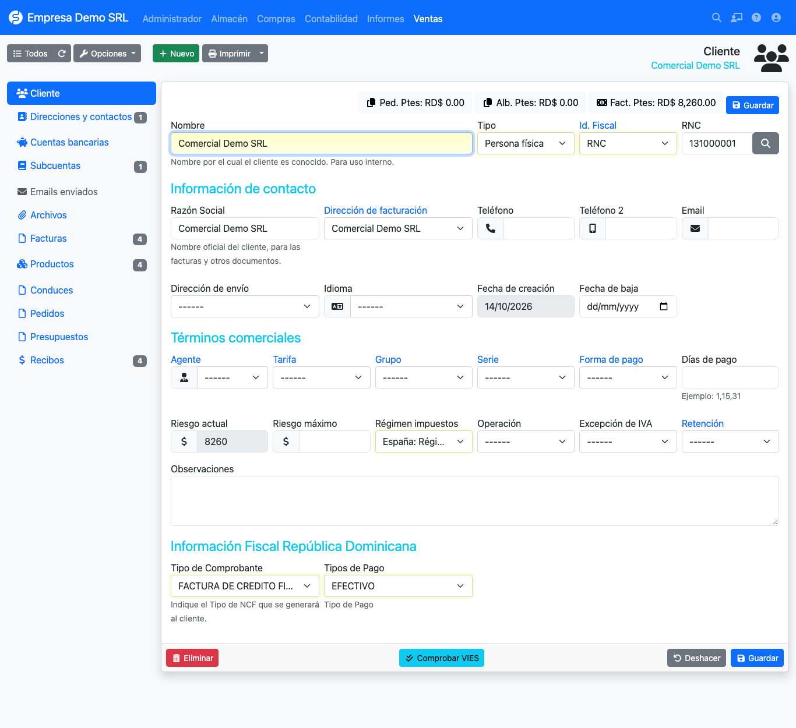

# RNC lookup

On the **customer** and **supplier** forms, the RNC or ID field includes a magnifier button that looks the taxpayer
up.

## How to use it

1. Open or create a customer or supplier.
2. Type the RNC or ID in the tax ID field.
3. Press the magnifier button. If the taxpayer exists, the plugin shows its data (name, trade name and status) so
   you can copy it to the form.
4. If it does not exist, a warning says the RNC was not found.

## Lookup service

!!! info "External service"
    The lookup **does not use a local database**. The plugin sends the RNC to an external taxpayer lookup service
    and shows its response. It needs Internet access from the server and, when used, the number queried leaves your
    installation for that service. If your data policy does not allow it, do not use the button: the rest of the
    plugin works without it.

!!! note "Change from earlier versions"
    Older versions downloaded the DGII's full RNC list into a local table from *RNC list*. That screen no longer
    exists; the lookup is now a single query from the form.
