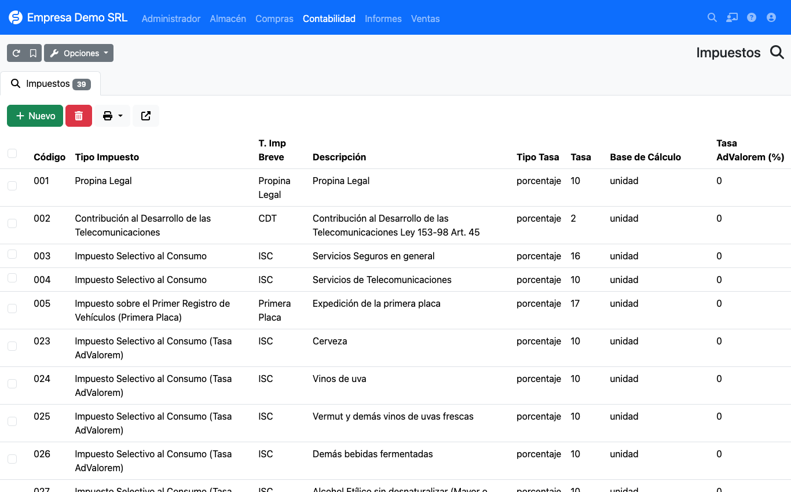
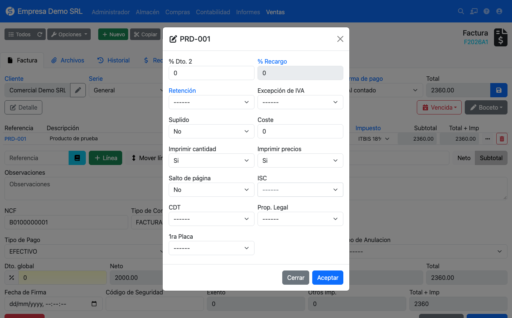

# Additional taxes (ISC)

Besides ITBIS, the plugin handles the DGII additional taxes in
**Accounting → Dominican Republic → Taxes**.



## Included catalog

| Codes | Tax | Calculation |
|-------|-----|-------------|
| 001 | Legal tip | Percentage (10 %) |
| 002 | CDT, Telecommunications Development Contribution | Percentage (2 %) |
| 003, 004 | ISC on insurance and telecommunications | Percentage |
| 005 | First vehicle license plate | Percentage (17 %) |
| 006 – 022 | Specific **plus** *ad valorem* ISC on alcohol and cigarettes | Fixed amount per unit or per liter of absolute alcohol, plus a percentage |
| 023 – 039 | *Ad valorem*-only ISC on alcohol and cigarettes | Percentage |

For alcohol and cigarettes use codes **006 – 022**: they apply the specific amount and the *ad valorem* percentage
in a single tax. Codes 023 – 039 apply the percentage only.

## How it is calculated

Each tax defines its **rate type**:

=== "Percentage"

    ```text
    amount = price before discount × rate / 100
    ```

=== "Amount"

    ```text
    specific     = factor × rate
    ad valorem   = base × ad valorem rate / 100
    ```

    The **factor** depends on the tax's *calculation base*:

    | Calculation base | Factor |
    |------------------|--------|
    | `unidad` (unit) | Line quantity |
    | `litros_alcohol_absoluto` | Quantity × content in liters × alcohol degrees / 100 |

    The *ad valorem* **base** is the price before discount, plus the specific amount when the tax has
    *ad valorem on specific* enabled.

!!! warning "Formulas pending validation"
    The code flags the specific ISC formulas as pending validation against Law 253-12 and the DGII e-CF technical
    description. **Confirm them with your accountant** before using them in production. It is also still open whether
    the ITBIS base should include ISC (today it is computed on the price before discount only).

## Applying it to a line

On the invoice line open the **···** (more options) button. The modal adds the **ISC**, **CDT**,
**Legal tip** and **1st plate** selectors.



- The ISC selector is searchable and shows **[Amount]** or **[Percentage]** in brackets.
- The calculated amount is stored on the line and later appears in the 606 and 607 reports.
- On **purchases** you can also type the **ISC amount manually** when the supplier invoice differs from the
  calculated one.
- The additional tax total is shown on the invoice as **Other taxes** and **Total + tax**.

## Alcohol and cigarettes: examples

### Alcoholic beverages (liters of absolute alcohol)

First fill in the product's **Alcohol degrees (%)** and **Content per unit (liters)**
(see [Products](productos.md)). Example with *014 – Rum and other cane spirits* (specific rate 632.58 per liter of
absolute alcohol and 10 % *ad valorem*), 12 bottles of 0.7 L at 40 % alcohol, priced 500.00 each:

```text
liters of absolute alcohol = 12 × 0.7 × 40 / 100        =     3.36
specific ISC               = 3.36 × 632.58              = 2,125.47
ad valorem ISC             = (12 × 500.00) × 10 / 100   =   600.00
line ISC                   = 2,125.47 + 600.00          = 2,725.47
```

### Cigarettes (per unit)

With *019 – Cigarettes containing tobacco, pack of 20* (53.51 per pack and 20 % *ad valorem*), 10 packs at 200.00
each:

```text
specific ISC     = 10 × 53.51             =   535.10
ad valorem ISC   = (10 × 200.00) × 20/100 =   400.00
line ISC         = 535.10 + 400.00        =   935.10
```

### Other taxes (percentage only)

| Tax | Example | Calculation |
|-----|---------|-------------|
| 002 – CDT (2 %) | Service of 10,000.00 | 10,000.00 × 2 / 100 = **200.00** |
| 001 – Legal tip (10 %) | Consumption of 5,000.00 | 5,000.00 × 10 / 100 = **500.00** |

## Updating the rates every year

Specific ISC amounts are adjusted for inflation every year. To change them open
**Accounting → Dominican Republic → Taxes**, edit the tax and change its **rate**. Lines already saved keep
the amount they have stored.

!!! tip "The included rates are a reference"
    The rates for 006 – 022 are the ones in force when this version was published. Compare them with the DGII table
    for the current year before invoicing.

## When you update the plugin

Updating the plugin from an earlier version **automatically** loads any missing 006 – 022 codes and the tax's new
columns (calculation base and *ad valorem* rate). The update:

- does **not** modify taxes that already exist, so a rate you edited is kept;
- calculates the amount of old lines that only had the percentage stored;
- can run more than once without duplicating anything.
