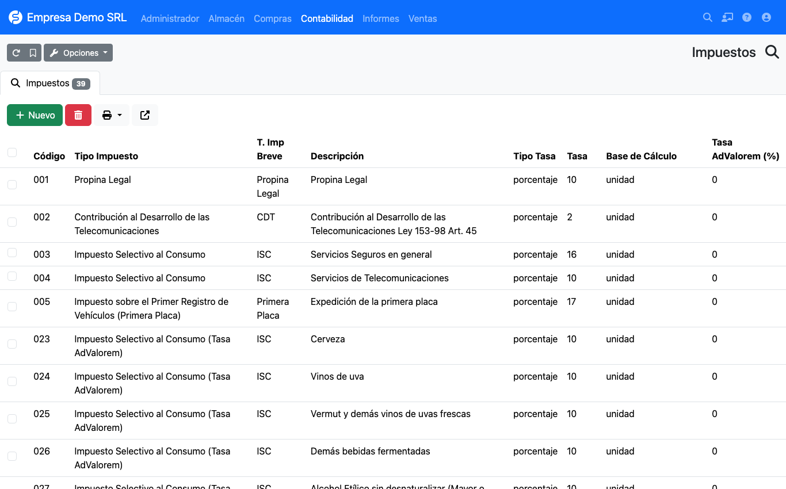
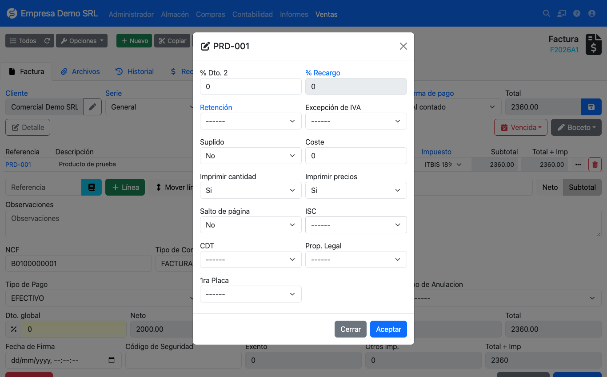

# Impuestos adicionales (ISC)

Además del ITBIS, el plugin maneja los impuestos adicionales de la DGII en la lista
**Contabilidad → República Dominicana → Impuestos**.



## Catálogo incluido

| Códigos | Impuesto | Forma de cálculo |
|---------|----------|------------------|
| 001 | Propina legal | Porcentaje (10 %) |
| 002 | CDT, Contribución al Desarrollo de las Telecomunicaciones | Porcentaje (2 %) |
| 003, 004 | ISC de seguros y de telecomunicaciones | Porcentaje |
| 005 | Primera placa de vehículos | Porcentaje (17 %) |
| 006 – 022 | ISC específico de alcoholes y cigarrillos | Monto fijo por unidad o por litro de alcohol absoluto |
| 023 – 039 | ISC *ad valorem* de alcoholes y cigarrillos | Porcentaje |

## Cómo se calcula

Cada impuesto define su **tipo de tasa**:

=== "Porcentaje"

    ```text
    monto = precio sin descuento × tasa / 100
    ```

=== "Monto"

    ```text
    específico   = factor × tasa
    ad valorem   = base × tasa ad valorem / 100
    ```

    El **factor** depende de la *base de cálculo* del impuesto:

    | Base de cálculo | Factor |
    |-----------------|--------|
    | `unidad` | Cantidad de la línea |
    | `litros_alcohol_absoluto` | Cantidad × contenido en litros × grados de alcohol / 100 |

    La **base** del *ad valorem* es el precio sin descuento, más el monto específico si el impuesto tiene
    activada la opción *ad valorem sobre específico*.

!!! warning "Fórmulas pendientes de validación"
    El código marca las fórmulas del ISC específico como pendientes de validar contra la Ley 253-12 y la descripción
    técnica del e-CF. Antes de usarlas en producción, **confírmelas con su contador**. También está por definir si la
    base del ITBIS debe incluir el ISC (hoy se calcula solo sobre el precio sin descuento).

## Aplicarlo en una línea

En la línea de la factura abra el botón **···** (más opciones). El modal agrega los selectores **ISC**, **CDT**,
**Prop. Legal** y **1ra Placa**.



- El selector de ISC tiene búsqueda e indica entre corchetes si el impuesto es por **[Monto]** o **[Porcentaje]**.
- El monto calculado se guarda en la línea y aparece luego en los reportes 606 y 607.
- En **compras** puede además escribir el **monto de ISC manualmente** cuando el de la factura del proveedor difiera
  del calculado.
- El total de impuestos adicionales se muestra en la factura como **Otros Imp.** y **Total + Imp**.
