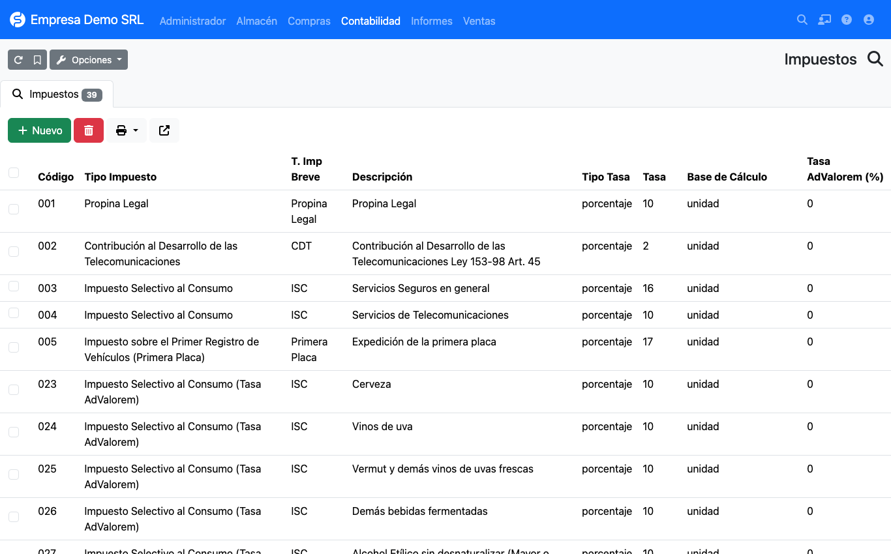
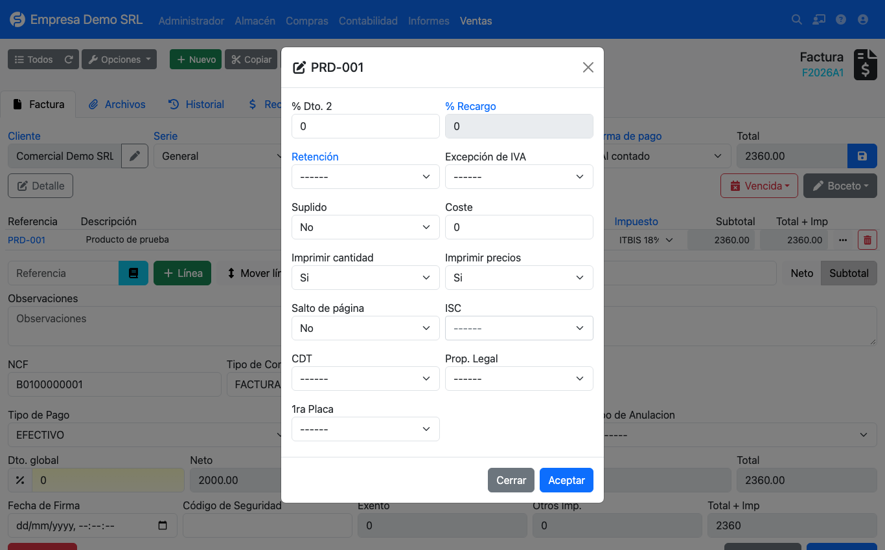

# Impuestos adicionales (ISC)

Además del ITBIS, el plugin maneja los impuestos adicionales de la DGII en la lista
**Contabilidad → República Dominicana → Impuestos**.



## Catálogo incluido

| Códigos | Impuesto | Forma de cálculo |
|---------|----------|------------------|
| 001 | Propina legal | Porcentaje (10 %) |
| 002 | CDT, Contribución al Desarrollo de las Telecomunicaciones | Porcentaje (2 %) |
| 003, 004 | ISC de seguros y de telecomunicaciones | Porcentaje |
| 005 | Primera placa de vehículos | Porcentaje (17 %) |
| 006 – 022 | ISC específico **más** *ad valorem* de alcoholes y cigarrillos | Monto fijo por unidad o por litro de alcohol absoluto, más un porcentaje |
| 023 – 039 | ISC solo *ad valorem* de alcoholes y cigarrillos | Porcentaje |

Para alcoholes y cigarrillos use los códigos **006 – 022**: aplican el monto específico y el porcentaje *ad valorem*
en un solo impuesto. Los códigos 023 – 039 aplican únicamente el porcentaje.

## Cómo se calcula

Cada impuesto define su **tipo de tasa**:

=== "Porcentaje"

    ```text
    monto = precio sin descuento × tasa / 100
    ```

=== "Monto"

    ```text
    específico   = factor × tasa
    ad valorem   = base × tasa ad valorem / 100
    ```

    El **factor** depende de la *base de cálculo* del impuesto:

    | Base de cálculo | Factor |
    |-----------------|--------|
    | `unidad` | Cantidad de la línea |
    | `litros_alcohol_absoluto` | Cantidad × contenido en litros × grados de alcohol / 100 |

    La **base** del *ad valorem* es el precio sin descuento, más el monto específico si el impuesto tiene
    activada la opción *ad valorem sobre específico*.

!!! warning "Fórmulas pendientes de validación"
    El código marca las fórmulas del ISC específico como pendientes de validar contra la Ley 253-12 y la descripción
    técnica del e-CF. Antes de usarlas en producción, **confírmelas con su contador**. También está por definir si la
    base del ITBIS debe incluir el ISC (hoy se calcula solo sobre el precio sin descuento).

## Aplicarlo en una línea

En la línea de la factura abra el botón **···** (más opciones). El modal agrega los selectores **ISC**, **CDT**,
**Prop. Legal** y **1ra Placa**.



- El selector de ISC tiene búsqueda e indica entre corchetes si el impuesto es por **[Monto]** o **[Porcentaje]**.
- El monto calculado se guarda en la línea y aparece luego en los reportes 606 y 607.
- En **compras** puede además escribir el **monto de ISC manualmente** cuando el de la factura del proveedor difiera
  del calculado.
- El total de impuestos adicionales se muestra en la factura como **Otros Imp.** y **Total + Imp**.

## Alcohol y cigarrillos: ejemplos

### Bebidas alcohólicas (litros de alcohol absoluto)

Primero complete en el producto los **Grados de Alcohol (%)** y el **Contenido por Unidad (litros)**
(ver [Productos](productos.md)). Ejemplo con *014 – Ron y demás aguardientes de caña* (tasa específica
632.58 por litro de alcohol absoluto y 10 % *ad valorem*), 12 botellas de 0.7 L y 40 % de alcohol, a 500.00 cada una:

```text
litros de alcohol absoluto = 12 × 0.7 × 40 / 100        =     3.36
ISC específico             = 3.36 × 632.58              = 2,125.47
ISC ad valorem             = (12 × 500.00) × 10 / 100   =   600.00
ISC de la línea            = 2,125.47 + 600.00          = 2,725.47
```

### Cigarrillos (por unidad)

Con *019 – Cigarrillos que contengan tabaco cajetilla 20 unidades* (53.51 por cajetilla y 20 % *ad valorem*),
10 cajetillas a 200.00 cada una:

```text
ISC específico   = 10 × 53.51             =   535.10
ISC ad valorem   = (10 × 200.00) × 20/100 =   400.00
ISC de la línea  = 535.10 + 400.00        =   935.10
```

### Otros impuestos (solo porcentaje)

| Impuesto | Ejemplo | Cálculo |
|----------|---------|---------|
| 002 – CDT (2 %) | Servicio de 10,000.00 | 10,000.00 × 2 / 100 = **200.00** |
| 001 – Propina legal (10 %) | Consumo de 5,000.00 | 5,000.00 × 10 / 100 = **500.00** |

## Actualizar las tasas cada año

Los montos específicos del ISC se ajustan por inflación cada año. Para cambiarlos abra
**Contabilidad → República Dominicana → Impuestos**, edite el impuesto y cambie su **tasa**. Las líneas ya guardadas
conservan el monto que tienen almacenado.

!!! tip "Las tasas incluidas son referenciales"
    Las tasas de 006 – 022 son las vigentes al publicar esta versión. Compárelas con la tabla de la DGII del año en
    curso antes de facturar.

## Al actualizar el plugin

Al actualizar el plugin desde una versión anterior se cargan **automáticamente** los códigos 006 – 022 que falten y las
columnas nuevas del impuesto (base de cálculo y tasa *ad valorem*). La actualización:

- **no** modifica los impuestos que ya existen, así que una tasa que usted haya editado se conserva;
- calcula el monto de las líneas antiguas que solo tenían el porcentaje guardado;
- puede ejecutarse más de una vez sin duplicar nada.
