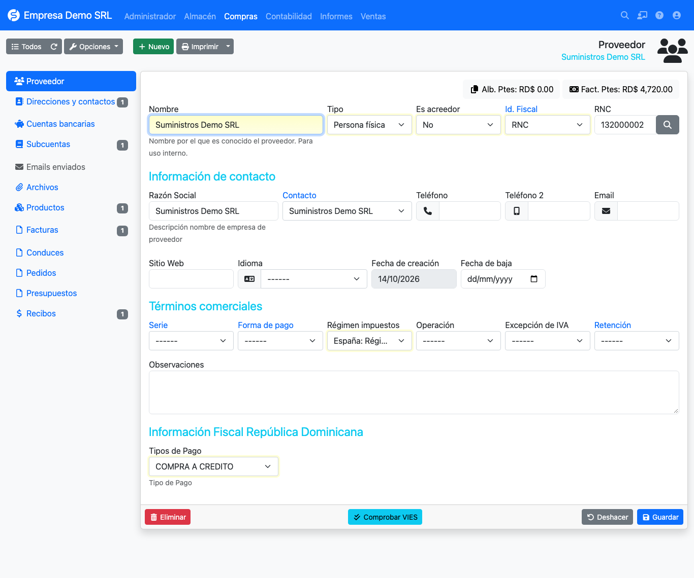

# Initial setup

## Menus added by the plugin

=== "Accounting → Dominican Republic"

    | Option | Purpose |
    |--------|---------|
    | **NCF master** | DGII-authorized receipt ranges. |
    | **NCF types** | Receipt type catalog (01–17 and 31–47). |
    | **Cancellation types** | DGII cancellation reasons (01–08). |
    | **Movement types** | Income (sales) and expense (purchases) classification. |
    | **Payment types** | DGII payment methods for sales and purchases. |
    | **Taxes** | Additional taxes: ISC, CDT, legal tip, first license plate. |

=== "Reports → Dominican Republic"

    | Option | Purpose |
    |--------|---------|
    | **Fiscal reports** | 606, 607, 608 and consolidated reports, with TXT export. |

## Recommended order

1. Make sure the **company** has its RNC under *Admin → Companies* (used in the reports).
2. Review the [receipt type](../referencia/tipos-comprobante.md) catalog and disable those you do not use.
3. Load your [NCF ranges](rangos.md).
4. Assign each **customer** a usual receipt type and payment type.
5. Mark each **product** as service or not, and set alcohol degrees and content if it carries
   [ISC](impuestos.md).

## Fields added to customers and suppliers

=== "Customer"

    - **Receipt type**: the one proposed when invoicing (for example 01 fiscal credit or 02 consumer).
    - **Payment type**: the payment method reported in the 607.

    

=== "Supplier"

    - **Payment type**: the agreed payment method, per DGII coding.

    

## DGII catalogs

Catalogs (NCF, cancellation, movement and payment types) come preloaded. Each list has a
**Restore original data** button to go back to factory values.

!!! warning "Restoring discards changes"
    Restoring deletes the catalog records and recreates them. Use it only to return to the initial state.
