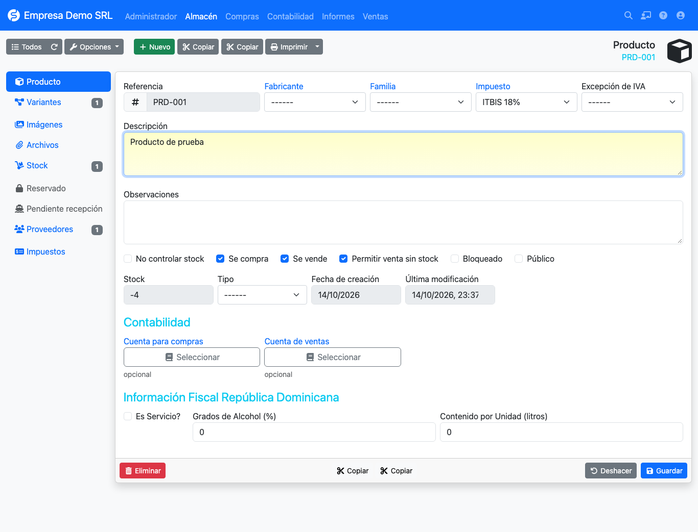

# Productos

El plugin agrega a la ficha del producto la sección **Información Fiscal República Dominicana**.



| Campo | Uso |
|-------|-----|
| **Es Servicio?** | Marca el producto como servicio. En el 606 separa el monto de servicios del de bienes. |
| **Grados de Alcohol (%)** | Grado alcohólico, usado en el ISC por litros de alcohol absoluto. |
| **Contenido por Unidad (litros)** | Litros que contiene una unidad, usado junto con los grados. |

## Ejemplo de ISC específico

Una botella de ron de 0.7 L y 40 % de alcohol, vendida en cantidad 10, con el impuesto *014 – Ron y demás
aguardientes de caña*, tiene un factor de:

```text
10 × 0.7 × 40 / 100 = 2.8 litros de alcohol absoluto
```

Ese factor se multiplica por la tasa del impuesto. Consulte [Impuestos adicionales](impuestos.md) para el detalle
y la advertencia sobre la validación de las fórmulas.
