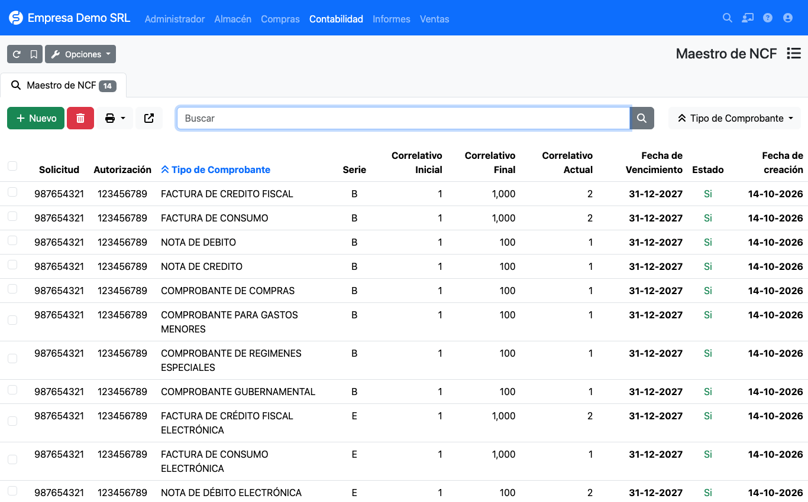

# Rangos de NCF

El **Maestro de NCF** (*Contabilidad → República Dominicana → Maestro de NCF*) guarda las secuencias que la DGII
le autorizó. El plugin toma el siguiente número del rango activo cada vez que guarda una factura.

## Campos de un rango

| Campo | Descripción |
|-------|-------------|
| **Tipo de comprobante** | Tipo de NCF al que pertenece el rango (ver [catálogo](../referencia/tipos-comprobante.md)). |
| **Serie** | `B` para comprobantes físicos y `E` para electrónicos (e-CF). |
| **Solicitud / Autorización** | Números entregados por la DGII al autorizar la secuencia. |
| **Correlativo inicial / final** | Límites de la secuencia autorizada. |
| **Correlativo actual** | Próximo número a utilizar. Lo incrementa el plugin. |
| **Fecha de vencimiento** | Vigencia de la secuencia. Se copia a la factura como fecha de vencimiento del NCF. |
| **Estado** | Solo los rangos activos se usan al facturar. |

## Formato del NCF generado

El NCF se arma como **serie + tipo + correlativo con ceros a la izquierda**:

| Serie | Largo del correlativo | Ejemplo |
|-------|-----------------------|---------|
| `B` (físico) | 8 dígitos | `B0100000001` |
| `E` (electrónico) | 10 dígitos | `E310000000001` |

## Cómo se elige el rango

Al guardar una factura sin NCF, el plugin busca, para la empresa y el tipo de comprobante de la factura, un rango
**activo** cuyo correlativo actual no supere el correlativo final. Si no encuentra ninguno muestra el error
*no hay rango de NCF para el tipo* y la factura no se guarda.

!!! tip "Evite quedarse sin secuencia"
    Cargue la siguiente autorización antes de agotar el rango actual. Con un rango agotado y sin otro activo,
    no se podrán emitir facturas de ese tipo.

## Tipos de comprobante que se generan en compras

En las facturas de **proveedor** el NCF lo escribe quien registra la factura, salvo en los comprobantes que emite
su propia empresa (**11**, **13**, **41** y **43**): para esos el plugin toma el número de sus rangos.
