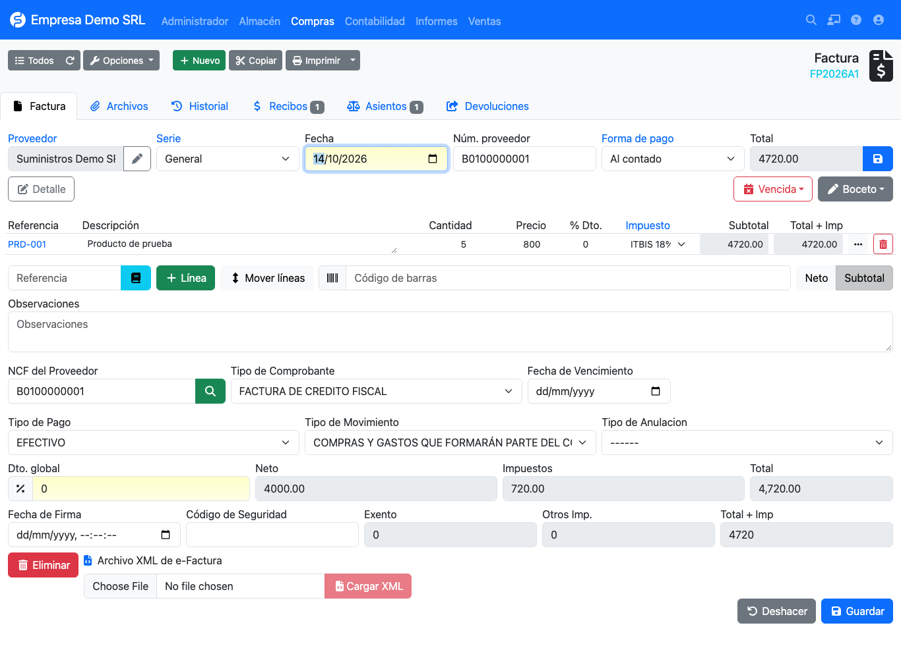

# Purchase invoices

On the supplier invoice the NCF **is given by the supplier**, so it is typed by hand and the plugin offers a
duplicate check.

## Fiscal fields

| Field | Description |
|-------|-------------|
| **Supplier NCF** | Number of the receipt received. A search button checks whether it was already recorded. |
| **Receipt type** | Only types flagged for purchases in the [catalog](../referencia/tipos-comprobante.md) are listed. |
| **Expiry date** | Validity of the supplier's NCF. |
| **Payment type** | Agreed payment method. Default *Cash*. |
| **Movement type** | Expense classification (01–11, default *Purchases and expenses forming part of cost of sales*). |
| **Cancellation type** | Reason, for cancelled receipts. |

## Checking an NCF before saving

Type the NCF, pick the supplier and press the magnifier button next to the NCF field.

- If the NCF **does not exist** for that supplier, the button turns green and the plugin fills the *Receipt type*
  from digits 2 and 3 of the NCF. It does not propose an expiry or signing date: they come from the XML or you type them.
- If it was already recorded, the button turns red and a warning shows the invoice and date where it exists.

## Receipts issued by your company

Receipts **11** (purchases), **13** (minor expenses), **41** and **43** (electronic equivalents) are issued by your
own company when buying from someone who does not provide a receipt. For those the plugin **generates the NCF** from
your [ranges](../configuracion/rangos.md), as in sales.

## Reports

Invoice data feeds the [606 report](../reportes/fiscales.md): it separates services from goods using the product's
*Is service* field, and reports ITBIS, ISC and other taxes from the lines.

!!! note "Uniqueness"
    The plugin does **not** enforce a unique NCF index on supplier invoices, because two different suppliers can issue
    the same number. Duplicate control is the magnifier-button check, which looks the NCF up for the same supplier.
