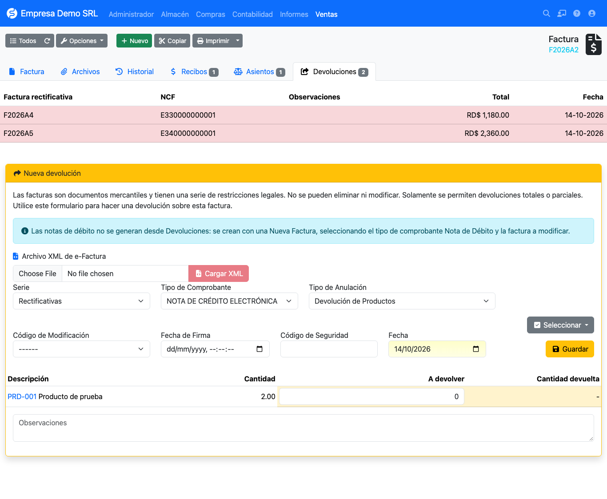
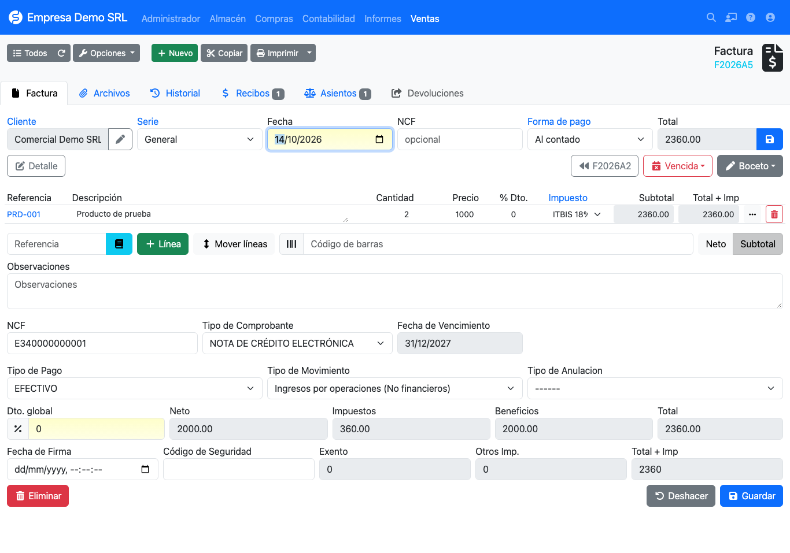
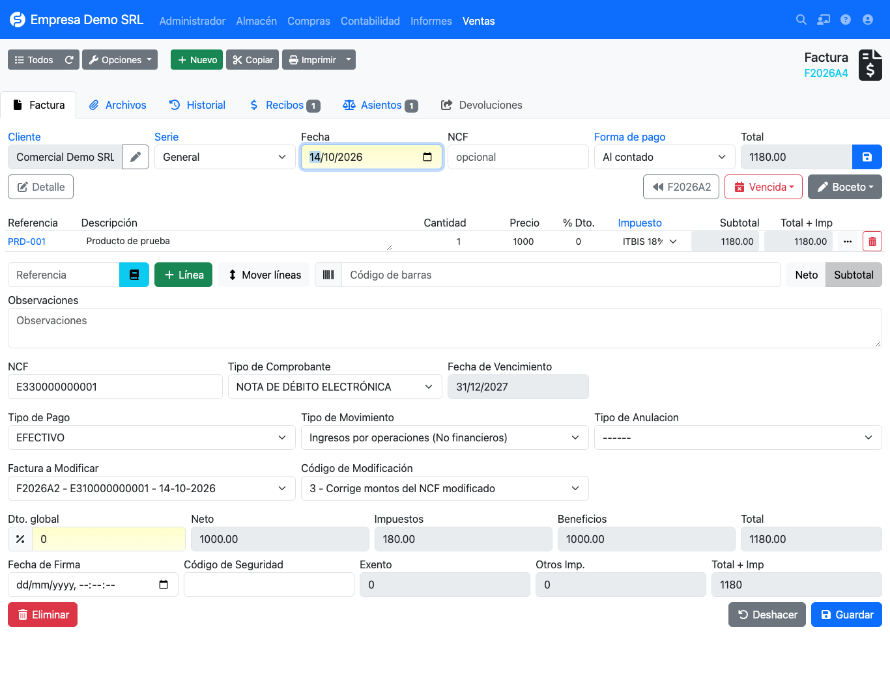

# Credit and debit notes

Any correction to an issued invoice is made with a note that **references the original invoice**.

| Note | Paper type | Electronic type | Where it is created |
|------|------------|-----------------|---------------------|
| Credit | 04 | **34** | **Returns** tab of the invoice |
| Debit | 03 | **33** | New invoice, choosing the receipt type |

## Credit note controls

When saving a credit note (04 or 34), the plugin rejects it with a message if:

- **The amount is positive.** A credit note must subtract: quantities or prices are negative (the *Returns* tab
  already does this).
- **It exceeds the invoice.** The note total, added to the other active (not cancelled) notes of the same invoice,
  cannot go over the total of the invoice it modifies.

To credit an amount without returning products, create the note with a line without a product and a negative
quantity or price. In the 606 and 607 that line is reported as goods.

## Credit notes: Returns tab

Open the original invoice and go to **Returns**. Notes already issued are listed on top with their NCF.

In the **New return** form:

| Field | Description |
|-------|-------------|
| **Load XML** | Fills NCF, type, date, signing date and security code from an already signed e-CF XML. |
| **Series** | *Rectifying* by default. |
| **Receipt type** | 04 is proposed for paper invoices and 34 for electronic ones. |
| **Cancellation type** | Reason, default *Product return*. |
| **Modification code** | What the note corrects: 1, 2 or 3. See [codes](../referencia/codigos-modificacion.md). |
| **Signing date / Security code** | e-CF data, when issued by another system. |
| **To return** | Quantity per line. *Select → All* returns the whole invoice. |

On save the note is created with its NCF, linked to the original invoice. If no other type is chosen, the plugin
assigns 04 (or 34 when the original invoice is electronic) and takes the NCF from that range; before, the note
inherited the customer's type and consumed a B01 NCF.

## Debit notes

!!! info "Debit notes do not come from Returns"
    A debit note **adds** to the original invoice, so it is created as a new invoice. The Returns tab shows a notice
    saying so.

1. Create a **new sales invoice** for the same customer.
2. In **Receipt type** choose **Electronic debit note (33)**.
3. Two new selectors appear:
    - **Invoice to modify**: invoices of the same customer and company (the 200 most recent).
    - **Modification code**: 1, 2 or 3.
4. Add the concept or amount to increase on the lines and save.

The selectors are shown only when the type is 33 and are cleared if you switch to another type. On save the plugin
validates that the invoice belongs to the same customer and company, and is not the document itself.

## Where it is reported

The modified invoice is stored as the note's rectified invoice. That is why the original NCF appears in the
**Modifies** column of the [606 and 607](../reportes/fiscales.md) reports, and the PDF prints the modified NCF and
the modification code.
