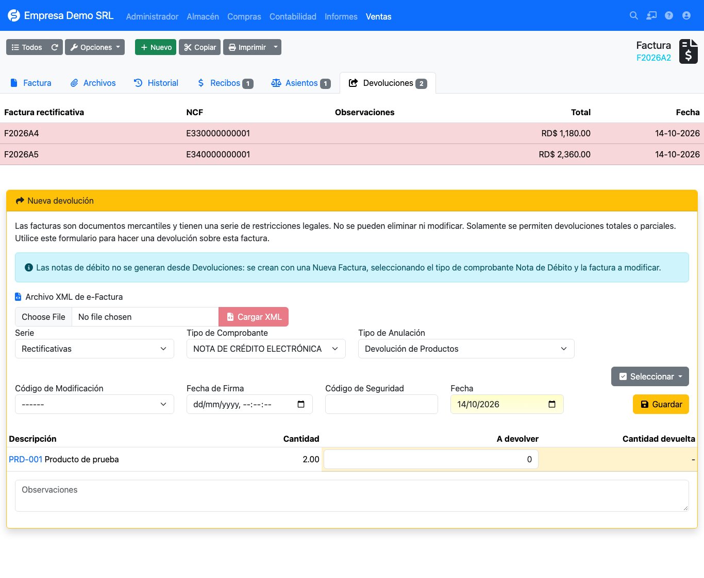
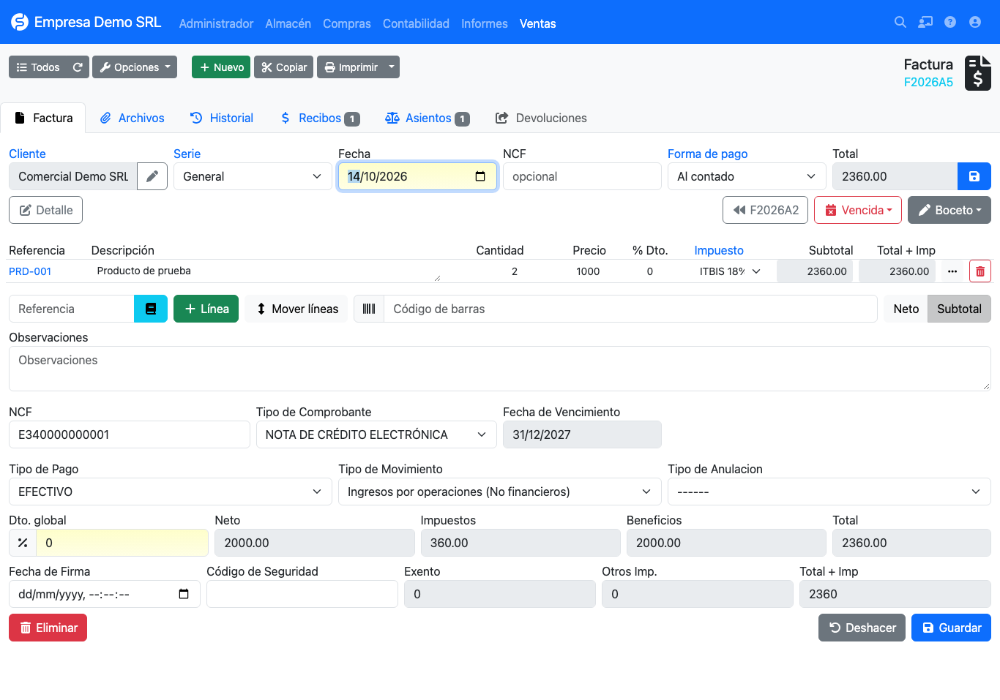
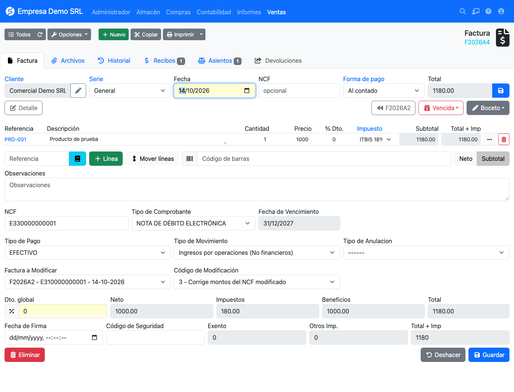

# Notas de crédito y débito

Cualquier corrección a una factura emitida se hace con una nota que **referencia la factura original**.

| Nota | Tipo físico | Tipo electrónico | Dónde se crea |
|------|-------------|------------------|---------------|
| Crédito | 04 | **34** | Pestaña **Devoluciones** de la factura |
| Débito | 03 | **33** | Nueva factura, eligiendo el tipo de comprobante |

## Notas de crédito: pestaña Devoluciones

Abra la factura original y vaya a **Devoluciones**. Las notas ya emitidas aparecen arriba, con su NCF.

En el formulario **Nueva devolución**:

| Campo | Descripción |
|-------|-------------|
| **Cargar XML** | Rellena NCF, tipo, fecha, fecha de firma y código de seguridad desde el XML de una e-CF ya firmada. |
| **Serie** | Por defecto *Rectificativas*. |
| **Tipo de Comprobante** | Se propone 04 para facturas físicas y 34 para electrónicas. |
| **Tipo de Anulación** | Motivo, por defecto *Devolución de Productos*. |
| **Código de Modificación** | Qué corrige la nota: 1, 2 o 3. Ver [códigos](../referencia/codigos-modificacion.md). |
| **Fecha de Firma / Código de Seguridad** | Datos de la e-CF, cuando la emite otro sistema. |
| **A devolver** | Cantidad por línea. Con *Seleccionar → Todo* se devuelve la factura completa. |

Al guardar se crea la nota con su NCF, enlazada a la factura original.

## Notas de débito

!!! info "Las notas de débito no salen de Devoluciones"
    Una nota de débito **suma** a la factura original, por lo que se crea como una factura nueva. La pestaña
    Devoluciones muestra un aviso con esta indicación.

1. Cree una **nueva factura de venta** para el mismo cliente.
2. En **Tipo de comprobante** elija **Nota de Débito Electrónica (33)**.
3. Aparecen dos selectores nuevos:
    - **Factura a Modificar**: facturas del mismo cliente y empresa (las 200 más recientes).
    - **Código de Modificación**: 1, 2 o 3.
4. Agregue en las líneas el concepto o monto a incrementar y guarde.

Los selectores solo se muestran cuando el tipo es 33 y se limpian si cambia a otro tipo. El plugin valida al guardar
que la factura pertenezca al mismo cliente y empresa, y que no sea el propio documento.

## Dónde se reporta

La factura modificada queda guardada como factura rectificada de la nota. Por eso el NCF original aparece en la
columna **Modifica** de los reportes [606 y 607](../reportes/fiscales.md), y el PDF imprime el NCF modificado y el
código de modificación.
