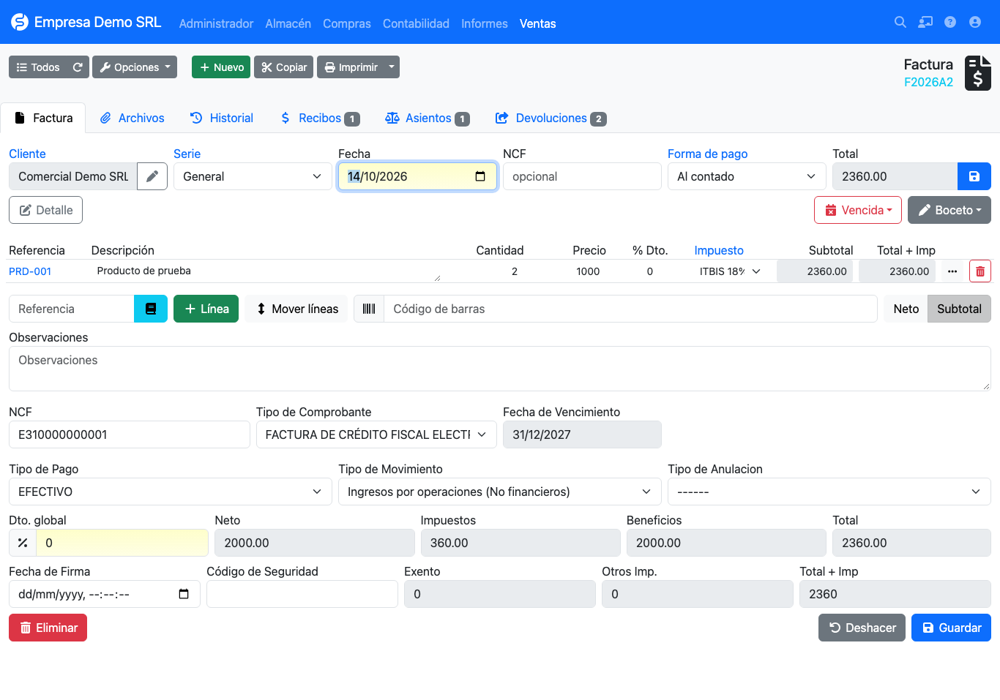

# fsRepublicaDominicana

**Dominican Republic tax localization** plugin for [FacturaScripts](https://facturascripts.com).
It adds fiscal receipt numbers (NCF), electronic fiscal receipts (e-CF), additional taxes (ISC, CDT, legal tip)
and the DGII 606, 607 and 608 reports to FacturaScripts.

!!! note "Screenshots"
    Screenshots are taken from a Spanish (Dominican Republic) installation.

## What is included

| Area | What the plugin does |
|------|----------------------|
| **NCF** | Master list of DGII-authorized ranges, automatic NCF generation when saving the invoice, sequence and expiry control. |
| **Receipt types** | Paper (01 to 17) and electronic (31 to 47) types. Default receipt type per customer. |
| **Notes** | Credit notes from *Returns* and debit notes with the invoice to modify and a modification code. |
| **e-CF** | e-CF XML upload, signing date, security code and printed representation. |
| **Taxes** | Specific and *ad valorem* ISC, CDT, legal tip and other taxes per line. |
| **Reports** | 606, 607, 608 and consolidated reports with TXT export for the DGII. |
| **RNC** | Taxpayer lookup from the customer and supplier forms. |

## Where to start

1. [Installation](instalacion.md): requirements and plugin activation.
2. [Initial setup](configuracion/inicial.md): plugin menus and recommended order.
3. [NCF ranges](configuracion/rangos.md): load your DGII authorizations.
4. [Sales invoices](facturas/ventas.md) and [purchase invoices](facturas/compras.md).

!!! info "Documented version"
    This documentation covers plugin **1.36** on FacturaScripts **2026.65**.

## Support and contributing

The plugin is open source (LGPL-3.0). Report issues or propose improvements on
[GitHub](https://github.com/joenilson/fsRepublicaDominicana/issues).
