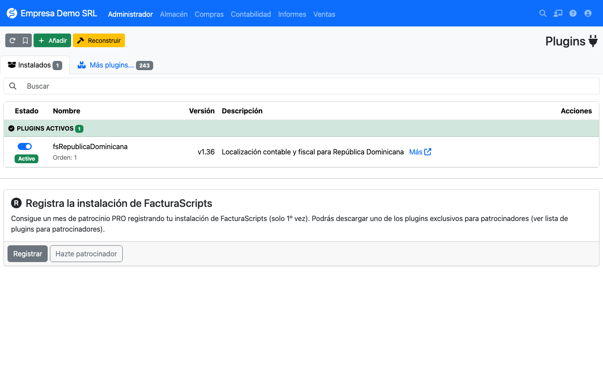

# Installation

## Requirements

- **FacturaScripts 2025 or later** (documented and tested with 2026.65).
- **MySQL / MariaDB** or **PostgreSQL** database.
- PHP with the extensions FacturaScripts requires (`gd`, `zip`, `intl`, `mbstring`, `curl`, `mysqli` or `pgsql`).
- Language **Spanish (Dominican Republic)** and country **Dominican Republic** when installing FacturaScripts.

!!! warning "Country and language"
    If FacturaScripts is installed with another country, taxes, chart of accounts and currency are not set up the
    way the plugin expects and **correct behavior cannot be guaranteed**.

## Installing the plugin

1. Download the plugin from [facturascripts.com](https://facturascripts.com/plugins/fsrepublicadominicana)
   or from the [repository](https://github.com/joenilson/fsRepublicaDominicana).
2. In FacturaScripts open **Admin → Plugins** and use **Add** to upload the ZIP.
3. Enable the plugin with the switch on its row.

When enabled, the plugin creates its tables (`rd_ncfrango`, `rd_ncftipo`, `rd_ncftipoanulacion`,
`rd_ncftipomovimiento`, `rd_ncftipopagos`, `rd_ncfmodificacion`, `rd_impuestosadicionales`), adds columns to
invoices, customers, suppliers and products, and loads the initial DGII catalogs.

## Upgrading

Upload the new ZIP from **Admin → Plugins** and press **Rebuild**. New columns and catalogs are created
automatically.

!!! warning "Earlier credit and debit notes"
    Since 1.37 notes are validated when saved. An earlier note that breaks the rules cannot be saved again until it
    is fixed. See [note controls](facturas/notas.md).

## Next step

Continue with the [initial setup](configuracion/inicial.md).
