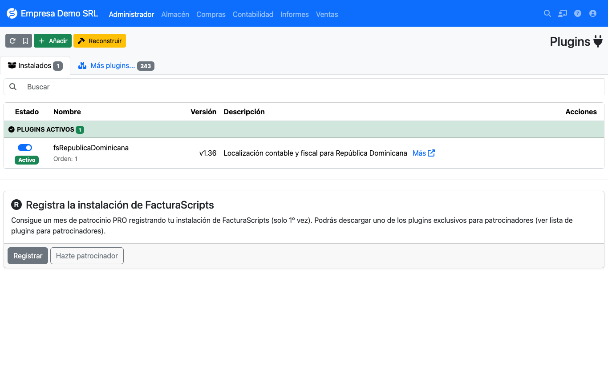

# Instalación

## Requisitos

- **FacturaScripts 2025 o superior** (documentado y probado con 2026.65).
- Base de datos **MySQL / MariaDB** o **PostgreSQL**.
- PHP con las extensiones que exige FacturaScripts (`gd`, `zip`, `intl`, `mbstring`, `curl`, `mysqli` o `pgsql`).
- Idioma **Español (República Dominicana)** y país **República Dominicana** al instalar FacturaScripts.

!!! warning "País e idioma"
    Si FacturaScripts se instala con otro país, las opciones de impuestos, plan contable y moneda no se
    configuran como espera el plugin y **no se puede garantizar su funcionamiento**.

## Instalar el plugin

1. Descargue el plugin desde [facturascripts.com](https://facturascripts.com/plugins/fsrepublicadominicana)
   o desde el [repositorio](https://github.com/joenilson/fsRepublicaDominicana).
2. En FacturaScripts abra **Administrador → Plugins** y use el botón **Añadir** para subir el ZIP.
3. Active el plugin con el interruptor de su fila.

Al activarlo, el plugin crea sus tablas (`rd_ncfrango`, `rd_ncftipo`, `rd_ncftipoanulacion`,
`rd_ncftipomovimiento`, `rd_ncftipopagos`, `rd_ncfmodificacion`, `rd_impuestosadicionales`), agrega columnas a
facturas, clientes, proveedores y productos, y carga los catálogos iniciales de la DGII.

## Actualizar

Suba la nueva versión del ZIP desde **Administrador → Plugins** y pulse **Reconstruir**. Las columnas y catálogos
nuevos se crean automáticamente.

## Siguiente paso

Continúe con la [configuración inicial](configuracion/inicial.md).
