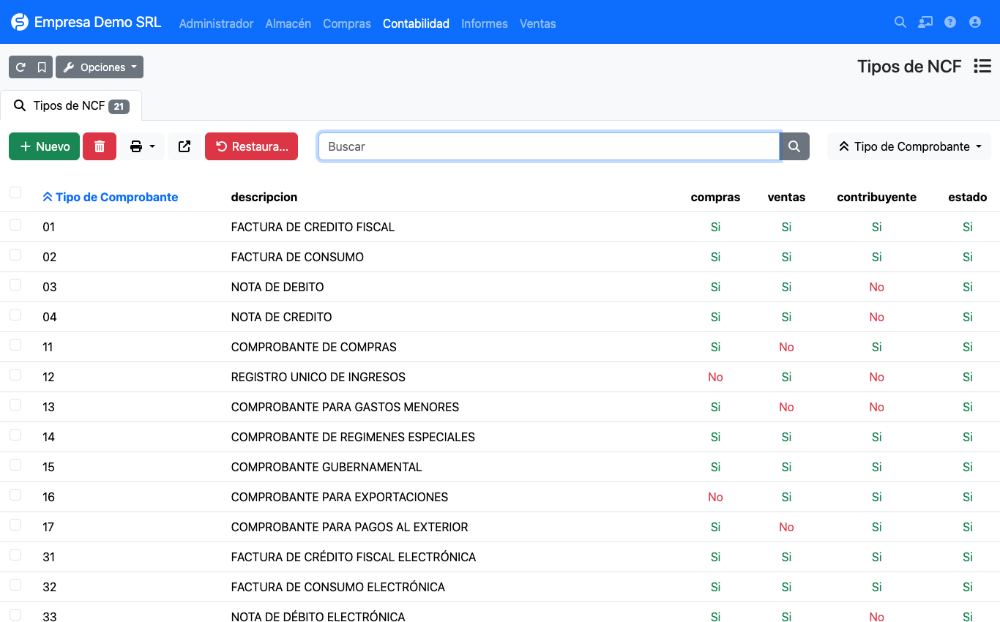

# Tipos de comprobante

Catálogo precargado en **Contabilidad → República Dominicana → Tipos de NCF**.

## Comprobantes físicos (serie B)

| Código | Descripción | Efecto | Ventas | Compras | Solo contribuyentes |
|--------|-------------|--------|:------:|:-------:|:-------------------:|
| 01 | Factura de crédito fiscal | Suma | Sí | Sí | Sí |
| 02 | Factura de consumo | Suma | Sí | Sí | Sí |
| 03 | Nota de débito | Suma | Sí | Sí | No |
| 04 | Nota de crédito | Resta | Sí | Sí | No |
| 11 | Comprobante de compras | Suma | No | Sí | Sí |
| 12 | Registro único de ingresos | Suma | Sí | No | No |
| 13 | Comprobante para gastos menores | Suma | No | Sí | No |
| 14 | Comprobante de regímenes especiales | Suma | Sí | Sí | Sí |
| 15 | Comprobante gubernamental | Suma | Sí | Sí | Sí |
| 16 | Comprobante para exportaciones | Suma | Sí | No | Sí |
| 17 | Comprobante para pagos al exterior | Suma | No | Sí | Sí |

## Comprobantes electrónicos (serie E)

| Código | Descripción | Efecto | Ventas | Compras | Solo contribuyentes |
|--------|-------------|--------|:------:|:-------:|:-------------------:|
| 31 | Factura de crédito fiscal electrónica | Suma | Sí | Sí | Sí |
| 32 | Factura de consumo electrónica | Suma | Sí | Sí | Sí |
| 33 | Nota de débito electrónica | Suma | Sí | Sí | No |
| 34 | Nota de crédito electrónica | Resta | Sí | Sí | No |
| 41 | Comprobante electrónico de compras | Suma | No | Sí | Sí |
| 43 | Comprobante electrónico para gastos menores | Suma | No | Sí | No |
| 44 | Comprobante electrónico para regímenes especiales | Suma | Sí | Sí | Sí |
| 45 | Comprobante electrónico gubernamental | Suma | Sí | Sí | Sí |
| 46 | Comprobante electrónico para exportaciones | Suma | Sí | Sí | Sí |
| 47 | Comprobante electrónico para pagos al exterior | Suma | No | Sí | Sí |

!!! tip "Desactive lo que no use"
    Cada tipo tiene un **estado**. Desactive los que su empresa no emite para que no aparezcan en el selector de las
    facturas.
