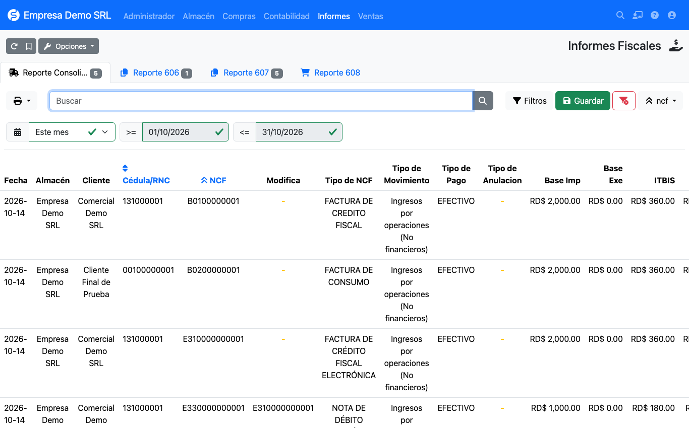
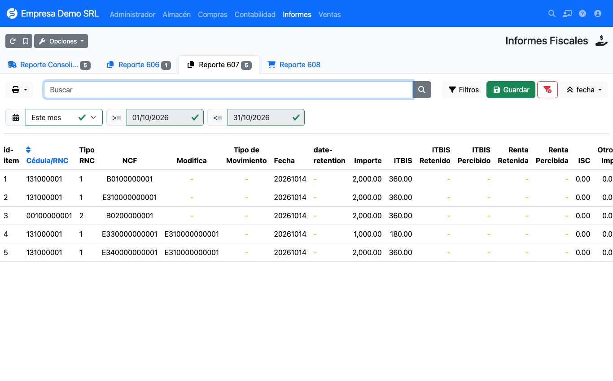
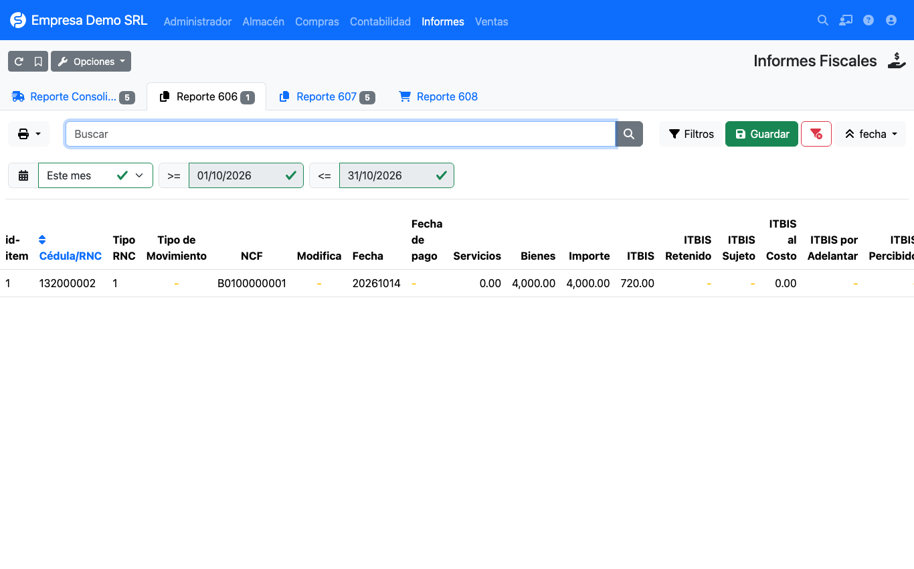
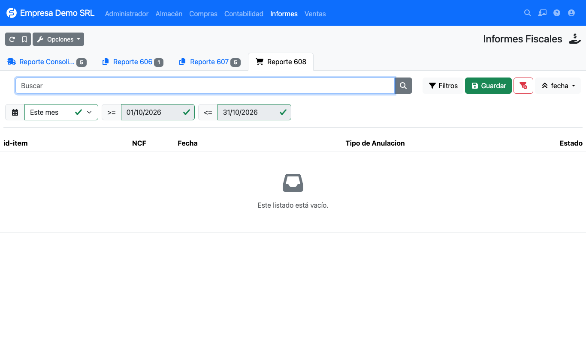

# Fiscal reports

**Reports → Dominican Republic → Fiscal reports** gathers the reports filed with the DGII.



| Tab | Content |
|-----|---------|
| **Consolidated report** | All sales invoices of the period, with ITBIS, NCF type, movement, payment and cancellation. Useful for reconciling. |
| **Report 606** | Purchases of goods and services (supplier invoices). |
| **Report 607** | Sales of goods and services (customer invoices). |
| **Report 608** | Cancelled receipts. |

## Filtering by period

!!! warning "The default period is the previous month"
    The page opens on the **previous month**, which is normally the one you file. To see the current month change
    the period selector to **This month** or enter start and end dates.

## Report 607 (sales)



For every invoice in the period it shows:

- customer RNC or ID and identification type;
- NCF and, on credit and debit notes, the **modified NCF**;
- movement type (income) and date;
- amount, ITBIS, **ISC**, other taxes and legal tip;
- breakdown by payment method: cash, check/transfer, card, credit, vouchers, barter and other;
- status (*Active* or *Cancelled*).

## Report 606 (purchases)



Per supplier invoice it shows: RNC, expense type (movement type), NCF and modified NCF, receipt and payment dates,
**amount in services and goods** (from the product's *Is service*), billed ITBIS, ISC, other taxes and legal tip.

## Report 608 (cancelled)



Lists cancelled NCFs with the **cancellation type** and date. For an invoice to appear here set it to the
**Cancelled** status and record the *Cancellation type*.

## Exporting for the DGII

On each tab (606, 607 or 608) use the print/export button and choose **TXT DGII**. The plugin generates a file named:

```text
DGII_F_<report>_<company RNC>_<year>_<month>.TXT
```

The first line is the header: `report|RNC|YYYYMM|record count`, followed by one record per line with fields
separated by `|`.

!!! warning "Validate before filing"
    Always compare the TXT with the DGII's official templates before uploading it. Still to be verified: the ISC,
    other taxes and legal tip columns in the TXT, the 606 payment date and the sign of electronic credit notes (34).
    See [Limitations](../referencia/limitaciones.md).
